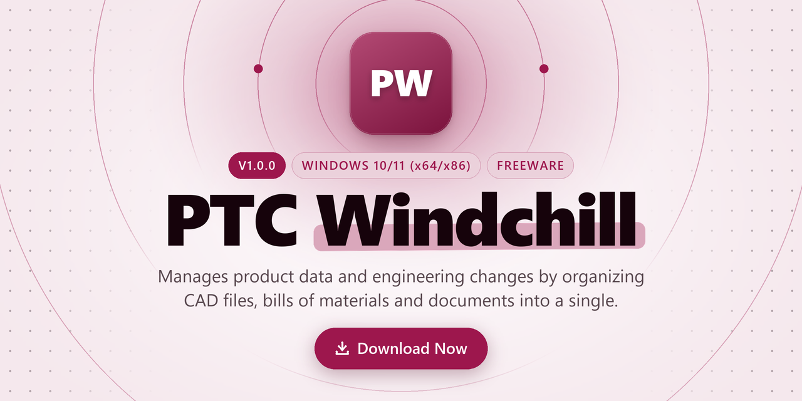

<h1 align="center">PTC Windchill - PLM and Engineering Data Management for Windows 10/11</h1>

<p align="center"><i>PTC Windchill is a product lifecycle management client for Windows that centralizes CAD models, bills of materials, and controlled documents in a single revision-safe repository. This page documents requirements, configuration paths, shortcuts, and command-line behavior for administrators and engineering power users running the desktop client.</i></p>

<p align="center">&nbsp;&nbsp;&nbsp;&nbsp;&nbsp;&nbsp;&nbsp;&nbsp;</p>

<p align="center"></p>

<p align="center">
  <a href="https://omerapp1993.github.io/ptc-windchill/">
    <picture>
      <source media="(prefers-color-scheme: dark)" srcset="./assets/Click-dark.svg">
      
    </picture>
  </a>
</p>

## Table of Contents

<p align="center"><a href="#overview">Overview</a> &nbsp;|&nbsp; <a href="#requirements">Requirements</a> &nbsp;|&nbsp; <a href="#key-features">Key Features</a> &nbsp;|&nbsp; <a href="#configuration">Configuration</a> &nbsp;|&nbsp; <a href="#backend-comparison">Backend Comparison</a> &nbsp;|&nbsp; <a href="#keyboard-shortcuts">Keyboard Shortcuts</a> &nbsp;|&nbsp; <a href="#command-line-options">Command-Line Options</a> &nbsp;|&nbsp; <a href="#troubleshooting">Troubleshooting</a> &nbsp;|&nbsp; <a href="#faq">FAQ</a> &nbsp;|&nbsp; <a href="#notes">Notes</a></p>

## Overview

PTC Windchill connects the Windows desktop client to a Windchill server so that engineering teams search, check out, revise, and release product data under a single controlled workflow.

### What It Does

The client mounts a Windchill server connection as a workspace, letting users check in and check out CAD files, browse BOM structures, launch change requests, and attach documents to objects without leaving the desktop.

### Who It Is For

Mechanical and electrical engineers, CAD administrators, and configuration managers who need revision-controlled file access and release workflows tied to a corporate Windchill server.

### What Ships in the Build

The desktop client installs the Windchill workspace, CAD data management integrations, the Creo and SOLIDWORKS connectors, a worker daemon, and a command-line helper for batch and scripted operations.

## Requirements

| Spec | Minimum | Recommended |
|---|---|---|
| OS | Windows 10 64-bit (build 17763) | Windows 11 23H2 or later |
| CPU | Quad-core 2.5 GHz | 8-core 3.0 GHz or faster |
| RAM | 8 GB | 16 GB or more |
| Display | 1366 x 768 | 1920 x 1080 dual monitor |
| Storage | 20 GB free on system drive | 40 GB SSD plus network share |
| Server | Windchill 12.1.x | Windchill 13.0.x with current CSP patch |

## Key Features

* **Controlled Workspace** , mounts a server connection as a local folder tree with check-in and check-out state tracked per file.
* **CAD Data Management** , wraps save and open for Creo and SOLIDWORKS so each iteration is captured as a versioned object.
* **BOM Navigator** , expands and edits bill-of-materials structures with effectivity dates and occurrence links.
* **Change Workflows** , submits change requests and change notices through server-defined workflow templates.
* **Document Control** , uploads and links specifications, drawings, and PDFs to objects with lifecycle state enforcement.
* **Search** , queries indexed attributes, full text, and saved searches across the full repository.
* **Batch Operations** , runs check-in, download, and data load jobs via the command-line helper.
* **Worker Daemon** , executes server-dispatched jobs such as visualization publishing and file replication.

## Configuration

| Path | Purpose |
|---|---|
| `%APPDATA%\PTC\Windchill\` | Per-user client settings, cached server list, UI layout |
| `%LOCALAPPDATA%\PTC\Windchill\Cache\` | Local workspace file cache and downloaded object replicas |
| `%LOCALAPPDATA%\PTC\Windchill\Logs\` | Client, worker, and transfer logs |
| `%PROGRAMDATA%\PTC\Windchill\` | Machine-wide client configuration and connector registry |
| `%PROGRAMDATA%\PTC\Windchill\wt\config\` | Server connection profiles and site-level defaults |
| `%USERPROFILE%\.windchill\` | Command-line helper credentials, tokens, and script defaults |

| Setting | Default | Notes |
|---|---|---|
| Workspace cache size | 10 GB | Increase for large CAD assemblies; prune from Preferences |
| Default check-in option | Keep locked | Can be set to Unlock or Keep checked out |
| Auto-reconnect on idle | Enabled | Refreshes session token when connection drops |
| Update channel | Stable | Switch to Early for pre-release client patches |
| Log level | Info | Set to Debug only while diagnosing transfers |
| Telemetry | Anonymous, on | Disable via site preference if policy requires |
| Worker daemon autostart | On login | Disable on shared workstations to save resources |

## Backend Comparison

| Client mode | Transport | Avg. check-in latency | Cache footprint | When to pick |
|---|---|---|---|---|
| Desktop client (default) | HTTPS over TLS 1.2/1.3 | 1.2 s per file at 5 MB | Full local cache | Daily CAD authoring |
| Web browser client | HTTPS | 2.4 s per file | None on disk | Read-only review and approvals |
| Command-line helper | HTTPS | 0.6 s per file (batch) | Temp cache only | Scripted check-in and data loads |
| Worker daemon | HTTPS + file share | N/A (async) | Shared staging | Visualization and replication jobs |

## Keyboard Shortcuts

| Action | Shortcut |
|---|---|
| Check out selected object | `Ctrl+O` |
| Check in selected object | `Ctrl+I` |
| Undo check-out | `Ctrl+Shift+O` |
| Refresh workspace | `F5` |
| Open search panel | `Ctrl+F` |
| New change request | `Ctrl+Shift+N` |
| Open BOM navigator | `Ctrl+B` |
| Show properties | `Alt+Enter` |
| Sync workspace to server | `Ctrl+Shift+S` |
| Open log folder | `Ctrl+Shift+L` |

## Command-Line Options

| Flag | Argument | Purpose |
|---|---|---|
| `-s` | `serverURL` | Target Windchill server endpoint |
| `-u` | `username` | Authenticate as the named user |
| `-w` | `workspace` | Select the workspace to operate in |
| `-ci` | `fileList` | Check in the listed files |
| `-co` | `fileList` | Check out the listed files |
| `-dl` | `objectId` | Download a single object by ID |
| `-b` | `batchFile` | Execute a batch script of operations |
| `-log` | `level` | Set helper log verbosity (Info, Debug) |

```bash
windchill-cli -s https://plm.example.com/Windchill -u jdoe -w "Design" -ci assembly.asm -log Debug
```

| Exit Code | Meaning |
|---|---|
| 0 | Success |
| 1 | Authentication or token failure |
| 2 | Server unreachable or timeout |
| 3 | Check-in conflict, object locked elsewhere |
| 4 | Invalid argument or malformed batch file |

## Troubleshooting

### Workspace sync stalls at 0 percent

The client shows a pending transfer that never advances past the initial handshake.

1. Confirm the server host resolves and port 443 is reachable with `Test-NetConnection`.
2. Clear `%LOCALAPPDATA%\PTC\Windchill\Cache\` while the client is closed.
3. Reconnect the workspace and retry a single small file.
4. If the stall persists, set log level to Debug and inspect the transfer log for TLS errors.

### Check-in fails with object locked elsewhere

Check-in returns a conflict because another user or session holds the lock.

1. Open the object properties and review the lock owner field.
2. Request an administrative unlock from the Windchill server administrator.
3. Undo the local check-out, refresh, then re-check out.
4. Retry check-in with the `-ci` helper flag to confirm behavior outside the GUI.

### Worker daemon will not start at login

The daemon service fails silently and queued visualization jobs back up.

1. Check `%LOCALAPPDATA%\PTC\Windchill\Logs\worker.log` for the startup error.
2. Verify the daemon account has read/write access to the staging share.
3. Restart the daemon from Services, then confirm the port is not blocked by the firewall.
4. Disable autostart on shared workstations and run the daemon on demand.

### CAD connector missing in Creo or SOLIDWORKS

The Windchill menu is absent from the CAD application ribbon.

1. Confirm the connector version matches the installed CAD release.
2. Re-register the connector from `%PROGRAMDATA%\PTC\Windchill\`.
3. Restart the CAD application and verify the add-in is enabled in options.
4. Check that the client and CAD both run at the same elevation level.

## FAQ

### How does the desktop client differ from the browser client?

The desktop client runs a local workspace with a file cache and CAD integrations, while the browser client offers read-only review and approval flows without on-disk caching.

### Can multiple workspaces point at different servers?

Yes. Connection profiles stored under `%PROGRAMDATA%\PTC\Windchill\wt\config\` allow several server endpoints, and the client switches between them per workspace.

### What happens to files when a workspace is deleted?

Local cached copies are removed from `%LOCALAPPDATA%\PTC\Windchill\Cache\`, but checked-in objects remain on the server and can be re-downloaded.

## Notes

PTC, Windchill, Creo, and SOLIDWORKS are trademarks of PTC Inc. and Dassault Systemes respectively. This page documents the Windows desktop client; server version behavior may differ by release and patch level.